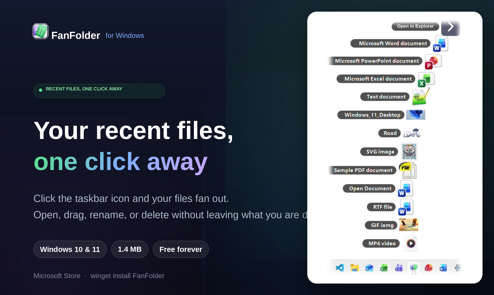

# FanFolder

**Your latest files, one click away from the Windows taskbar.**



Stop digging through File Explorer for files you just used. FanFolder puts your recent documents (or any folder you choose) directly on the taskbar. Click the icon and the files fan out. Open, drag, copy, rename, or delete them with the same Windows actions you already know.

Use it for recent documents, an active project folder, Downloads, or whatever you open often.

FanFolder is a native Win32/C++ app. No .NET runtime needed. The executable is about 1.4 MB.

**Homepage:** <https://olebhartvigsen.github.io/FanFolder/>

---

## License

FanFolder is proprietary software, free to use for personal and commercial use forever. The source code is not publicly distributed. See [LICENSE](LICENSE.md) for full terms.

If you find FanFolder useful, an optional "buy me a coffee" donation is appreciated but never required.

---

## Features

- Arc-shaped popup that opens from the taskbar
- Multiple animation styles: Fan, Glide, Spring, Fade, None
- Icons resize automatically, with actual Windows shell icons and thumbnails
- Pick your folder, sort order, item count, and filter by filename
- Sort by date modified, date created, or name
- Right-click any item for the full Windows context menu (open, copy, delete, rename...)
- Drag items out of the menu and drop them into other applications
- Drop files from Explorer onto the fan menu to move them into the watched folder
- Optionally include files from subfolders
- Watches the selected folder and updates the fan when files are added, removed, or renamed, even while the fan is closed
- Show or hide file extensions
- All settings live in the Windows registry. Change them from the tray icon menu

---

## Requirements

- Windows 10 or 11 (x64 or ARM64)
- No runtime dependencies

---

## Installation

### winget (recommended)

```powershell
winget install OleBhartvigsen.FanFolder
```

### Download the MSI

Grab the installer from the latest release:

- [x64 MSI](https://github.com/olebhartvigsen/FanFolder/releases/latest/download/FanFolderSetup-x64.msi)
- [ARM64 MSI](https://github.com/olebhartvigsen/FanFolder/releases/latest/download/FanFolderSetup-arm64.msi)

### Build the MSI yourself

Build and package in one step (requires Visual Studio Build Tools 2022 and WiX 4):

```powershell
.\installer\Build-Installer.ps1
# Output: installer\output\FanFolderSetup.msi
```

### Manual install

```powershell
.\installer\Install.ps1 -AddToStartup
```

### Run directly

```powershell
.\FanFolder\build\Release\FanFolder.exe
```

---

## Building from source

Requires Visual Studio 2022 (or Build Tools) with the C++ workload.

```powershell
# Configure (first time only)
cmake -B FanFolder\build -G "Visual Studio 17 2022" -A x64 -S FanFolder

# Build
cmake --build FanFolder\build --config Release
```

Output: `FanFolder\build\Release\FanFolder.exe`

---

## Anonymous installation telemetry

FanFolder sends two anonymous events to the FanFolder Aptabase project in the EU. `app_installed` goes out once after a successful first launch. `app_updated` goes out on the first launch after the application version changes. Both use the Windows WinHTTP API, run in the background with a short timeout, and are skipped entirely when there is no network. They do not block startup. Release and debug builds send them unless you disable telemetry in the registry.

Both events carry the running version in the `version` prop, alongside a random per-user installation identifier, CPU architecture, and the platform identifier `Windows`. `app_updated` also includes `from_version` and `to_version`. Aptabase may derive coarse region information from the network request. FanFolder does not send usernames, folder paths, filenames, account information, or file activity. Aptabase can receive normal network metadata associated with the HTTPS request. The identifier and the last reported version are stored under `HKEY_CURRENT_USER\SOFTWARE\FanFolder`. An event is only marked as sent after a successful response, so a failed delivery is retried on a later launch.

To opt out before launching FanFolder, run:

```powershell
New-Item -Path "HKCU:\SOFTWARE\FanFolder" -Force | Out-Null
Set-ItemProperty -Path "HKCU:\SOFTWARE\FanFolder" -Name "TelemetryEnabled" -Type DWord -Value 0
```

To re-enable it:

```powershell
Set-ItemProperty -Path "HKCU:\SOFTWARE\FanFolder" -Name "TelemetryEnabled" -Type DWord -Value 1
```

---

## Settings

All settings live under `HKEY_CURRENT_USER\SOFTWARE\FanFolder` and can be changed via the **tray icon right-click menu** or directly in the registry.

### FolderPath

**Type:** `REG_SZ` | **Default:** `::RecentDocs::`

The folder whose contents are displayed in the fan menu. In addition to a normal filesystem path, three special virtual values are supported:

| Value | Shows |
|---|---|
| `::RecentDocs::` | Recently used documents aggregated from the Windows Jump Lists **(default)** |
| `::RecentFiles::` | Explorer's "Recent" list (`%APPDATA%\Microsoft\Windows\Recent`) |
| `::GraphRecent::` | Recent Office/M365 documents only, ordered by last-opened time |

```powershell
Set-ItemProperty -Path "HKCU:\SOFTWARE\FanFolder" -Name "FolderPath" -Value "C:\Users\You\Documents"
```

---

### SortMode

**Type:** `REG_SZ` | **Default:** `DateModifiedDesc`

| Value | Description |
|---|---|
| `DateModifiedDesc` | Most recently modified first **(default)** |
| `DateModifiedAsc` | Oldest modification first |
| `DateCreatedDesc` | Most recently created first |
| `DateCreatedAsc` | Oldest creation first |
| `NameAsc` | File name A → Z |
| `NameDesc` | File name Z → A |

```powershell
Set-ItemProperty -Path "HKCU:\SOFTWARE\FanFolder" -Name "SortMode" -Value "DateModifiedDesc"
```

---

### MaxItems

**Type:** `REG_DWORD` | **Default:** `15` | **Range:** 1 – 50 (tray menu offers 5 / 10 / 15 / 20 / 25)

Maximum number of items shown. The tray menu sets it in steps of 5; any value from 1 to 50 can be set directly in the registry.

```powershell
Set-ItemProperty -Path "HKCU:\SOFTWARE\FanFolder" -Name "MaxItems" -Value 10
```

---

### IncludeDirectories

**Type:** `REG_DWORD` | **Default:** `1`

Whether sub-folders appear alongside files. `1` = include, `0` = files only.

```powershell
Set-ItemProperty -Path "HKCU:\SOFTWARE\FanFolder" -Name "IncludeDirectories" -Value 0
```

---

### IncludeSubfolderFiles

**Type:** `REG_DWORD` | **Default:** `0`

Whether files inside subfolders of the selected folder also appear in the fan.
`1` = include, `0` = only files directly in the selected folder.

This does not add subfolders as items. Use `IncludeDirectories` for that.

```powershell
Set-ItemProperty -Path "HKCU:\SOFTWARE\FanFolder" -Name "IncludeSubfolderFiles" -Value 1
```

---

### ShowExtensions

**Type:** `REG_DWORD` | **Default:** `0`

Whether file extensions are shown in item labels. `1` = show, `0` = hide.

```powershell
Set-ItemProperty -Path "HKCU:\SOFTWARE\FanFolder" -Name "ShowExtensions" -Value 1
```

---

### FilterRegex

**Type:** `REG_SZ` | **Default:** *(empty, no filter)*

A regular expression, matched case-insensitively against each filename. Only matching items are shown.

```powershell
# Show only PDFs and Word documents
Set-ItemProperty -Path "HKCU:\SOFTWARE\FanFolder" -Name "FilterRegex" -Value "\.(pdf|docx?)$"

# Remove filter
Remove-ItemProperty -Path "HKCU:\SOFTWARE\FanFolder" -Name "FilterRegex" -ErrorAction SilentlyContinue
```

---

### AnimationStyle

**Type:** `REG_SZ` | **Default:** `Glide`

| Value | Effect |
|-------|--------|
| `Fan` | Items fly in one-by-one from the arc hinge, staggered (ease-out-quart). |
| `Glide` | All items drift upward while fading in together (ease-out-cubic). |
| `Spring` | Items scale in from zero with a slight overshoot bounce, staggered. |
| `Fade` | Instant layout, very short fade-in only. |
| `None` | Instant, no animation. |

```powershell
Set-ItemProperty -Path "HKCU:\SOFTWARE\FanFolder" -Name "AnimationStyle" -Value "Spring"
```

---

### ShowInfoOnLaunch

**Type:** `REG_DWORD` | **Default:** `0`

When set to `1`, the info panel (about FanFolder, with links to Buy Me a Coffee, the project homepage and error reporting) is shown every time the app starts. The same setting is available as a checkable item in the tray menu.

```powershell
Set-ItemProperty -Path "HKCU:\SOFTWARE\FanFolder" -Name "ShowInfoOnLaunch" -Value 1
```

---

### InfoScreenShown

**Type:** `REG_DWORD` | **Default:** `0` (absent on a fresh install)

One-time marker. FanFolder sets it to `1` after the first launch, so the info panel is shown once on a fresh install and never again unless `ShowInfoOnLaunch` is enabled. Deleting the value from the registry shows the panel on the next launch.

---

## Uninstall

```powershell
.\installer\Install.ps1 -Uninstall

# Remove registry settings
Remove-Item -Path "HKCU:\SOFTWARE\FanFolder" -Recurse -ErrorAction SilentlyContinue
```
